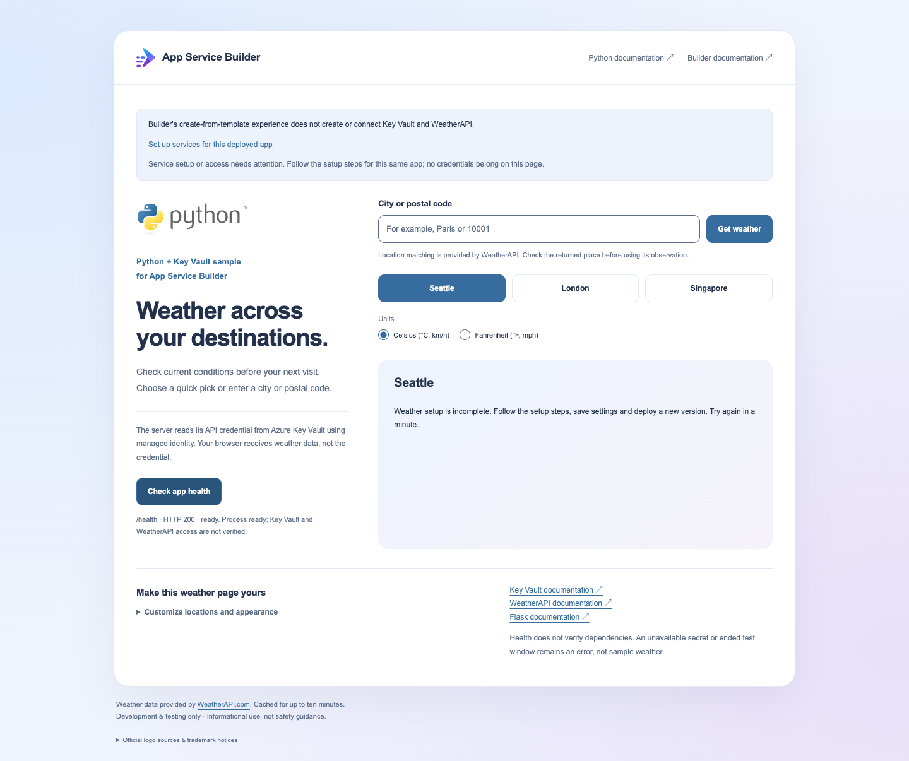

# Call a weather API with a Key Vault secret

A Python 3.14 dashboard on App Service Builder. Its server reads a dedicated WeatherAPI key from Azure Key Vault; visitors never receive that credential.

**External-service setup is manual.** Builder's create-from-template experience does not create or connect Key Vault or WeatherAPI. Deploy the app first, then follow [setup](#setup) for that **same app**. Missing settings must leave the page and liveness available, with weather requests returning 503 rather than invented conditions.

**Private Preview, development/test only.** Use an authorized Builder target with Python 3.14 support. Azure hosting/Key Vault and WeatherAPI have separate charges and terms. Current retained demo windows have expired; do not renew someone else's resources.

## Preview



The official Python and Builder branding, ecosystem links, destination picks, units, customization disclosure and inline liveness are preserved. This screenshot is local and not evidence of live Azure or WeatherAPI access.

## Setup

Start with your fork already deployed from the root `builder.yaml`. You need Azure CLI/Bicep, permission to create a vault in a dedicated service group, authority to assign roles on that vault, and your own WeatherAPI account/key. No second Builder app is needed.

1. **Create a dedicated vault.** Set your authorized subscription and an existing, dedicated service group (separate from shared workloads), then create only the vault:

   ```bash
   SUBSCRIPTION="<subscription-id>"
   RG="<dedicated-service-resource-group>"
   VAULT="<globally-unique-vault-name>"
   az login --tenant "<tenant-id>"
   az deployment group what-if --subscription "$SUBSCRIPTION" -g "$RG" \
     --template-file infra/main.bicep --parameters vaultName="$VAULT"
   az deployment group create --subscription "$SUBSCRIPTION" -g "$RG" \
     --template-file infra/main.bicep --parameters vaultName="$VAULT"
   VAULT_ID=$(az keyvault show --subscription "$SUBSCRIPTION" -g "$RG" \
     -n "$VAULT" --query id -o tsv)
   ```

   Review the what-if and costs before create. The template uses Standard, RBAC, a public endpoint and purge protection. The app must reach that endpoint; public reachability is not anonymous secret access. Provisioning needs resource-management permission in this group; role assignment requires separate role-assignment authority at the vault scope.
2. **Add the WeatherAPI key securely.** In [WeatherAPI](https://www.weatherapi.com/), create your own account, review the plan/terms and obtain a dedicated API key. Your human operator needs **Key Vault Secrets Officer** on this dedicated vault (not the app identity); have a role-assignment administrator use **vault > Access control (IAM) > Add role assignment** for that operator. In **vault > Objects > Secrets > Generate/Import**, choose manual entry, name it `weather-api-key`, paste the key there, enable it and set an expiry matching your own approved short test window. Never put the key in commands, Git, Builder variables, screenshots or browser code.
3. **Give this app read-only secret access.** In the existing Builder app's **Identity**, enable system-assigned identity and choose **Save and deploy**. Wait for success; record its **principal ID**, not client ID. Assign only:

   ```bash
   az role assignment create --subscription "$SUBSCRIPTION" \
     --assignee-object-id "<app-system-identity-principal-id>" \
     --assignee-principal-type ServicePrincipal \
     --role "Key Vault Secrets User" --scope "$VAULT_ID"
   ```

   The vault holds only this app's secret; the app cannot create/rotate it. Do not use Secrets Officer, Owner or subscription-wide roles for the app. Allow time for propagation.
4. **Save configuration AND deploy a new version.** In this app's **Variables > Add variables**, set `KEY_VAULT_URL` to **vault > Overview > Vault URI**, `KEY_VAULT_SECRET_NAME=weather-api-key` and `SAMPLE_EXPIRES_AT` to your approved future UTC deadline (`yyyy-MM-ddTHH:mm:ssZ`). Leave `AZURE_CLIENT_ID` unset; do not set `AZURE_AUTH_MODE=azure-cli` in Builder. Choose **Save and deploy**, follow **Deployments** to success and check the new active version. **Save only**, restarting or selecting an old version does not apply changed variables. If a save succeeded but deployment did not start, deploy current source instead of recreating the app. Optional installed Builder CLI:

   ```bash
   builder app deploy --name "<existing-app>" \
     --subscription "$SUBSCRIPTION" --resource-group "<app-group>" --rebuild
   ```

5. **Verify real conditions.** Open the returned HTTPS app URL, select Seattle and check real observation/retrieval timestamps. The request must be 200 with weather fields; then `/ready` can reflect that recent read:

   ```bash
   APP_URL="https://<returned-app-origin>"
   curl --fail-with-body "$APP_URL/health"
   curl --fail-with-body "$APP_URL/api/weather/seattle"
   curl --fail-with-body "$APP_URL/ready"
   ```

   `/health` is only liveness (`{"status":"ready"}`). It never verifies vault/provider access. `/ready` sends no cloud probe and is 503 before a successful read, after the verification/cache freshness window or after expiry. Cached observations do not prove current connectivity. With required Builder sign-in, use the authenticated browser for checks; an unauthenticated curl redirect is not weather success. Keep [visitor authentication](https://builder.appservice.azure.com/docs/guides/authentication/) separate from the managed identity's outbound role.
6. **Clean up owned resources only.** Delete your dedicated secret/vault and its app-specific role assignment when finished; revoke your WeatherAPI key/account plan as appropriate. Delete the app only if disposable. Do not delete a shared group or renew another owner's window. Vault soft delete/purge protection retains the name after deletion; app deletion does not remove the vault or cancel provider charges.

## Recovery

The runtime has a stable `./README.md#setup` link. It accepts no credentials and cannot create resources.

| Runtime category | Owner action |
|---|---|
| Configuration missing/invalid | Complete step 4 and deploy the same app. |
| Secret missing, disabled, expired or invalid | Create/enable/rotate the secret directly in your vault; respect its approved expiry. Wait for the short failure cache before retrying. |
| Identity unavailable | Verify system identity and its successful deployment. |
| Vault denied | Verify Secrets User on this vault; a 403 may also be a network rule, not conclusively RBAC. |
| Vault unreachable / weather unavailable | Check the configured endpoint and network/provider status. |
| Provider auth / quota | Check the dedicated WeatherAPI key, plan and limits. No raw provider details are returned. |
| Demo expired (410) | Stop. Any new window requires the resource owner's approval, a matching secret expiry and a new app version. |

Failures remain non-2xx and sanitize credentials/raw diagnostics. Retry is explicit; server failure caching and request caps remain in force. Secret reads fail closed—there is no anonymous/provider-key fallback or stale fabricated success.

## Local checks and customization

See [local preview, tests, caching and location configuration](docs/development.md). The preview fixture is explicitly synthetic and cannot verify integration. The app's startup path now supports missing vault/deadline settings without contacting Azure. The root manifest retains `/health` as liveness; dependency readiness is separate.

Customize `WEATHER_LOCATIONS`, `templates/index.html` and `static/style.css` in your fork, test and explicitly redeploy intended source. The page cannot discover or edit your fork.

- [Builder external-service connections](https://builder.appservice.azure.com/docs/guides/connect-to-services/).
- [Key Vault RBAC](https://learn.microsoft.com/azure/key-vault/general/rbac-guide).
- [WeatherAPI documentation](https://www.weatherapi.com/docs/) and [pricing](https://www.weatherapi.com/pricing.aspx).
- [Python branding](https://www.python.org/community/logos/). Unmodified ecosystem and supplied Builder marks are retained locally in `static/assets/`; trademarks belong to their owners.
